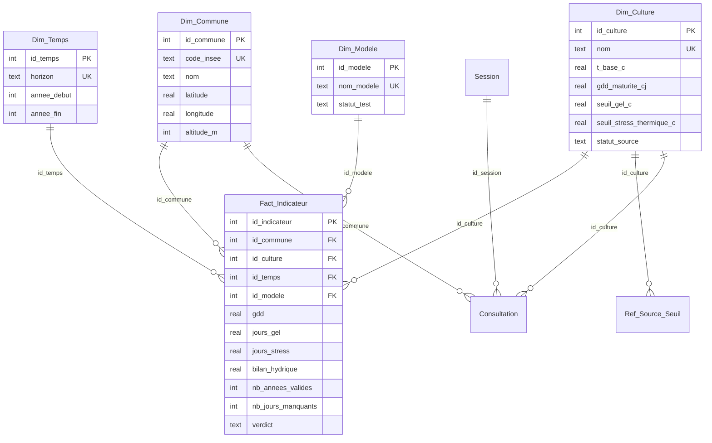

# Modèle de données — schéma en étoile (J2)

> Pôle DATA — Équipe 7. Version 1.0 du 15/10/2026. **Proposition de travail à valider à 5** : les points marqués ⚠ s'écartent d'une contribution J1 ou restent ouverts.
> Script : `DATA/creation_bdd.sql`. Requêtes : `DATA/requetes_etoile.sql`. Tests : `scripts/test_bdd.php`.

## 1. Principe

- **Une table de faits** (`Fact_Indicateur`) entourée de **4 dimensions** : `Dim_Commune`, `Dim_Culture`, `Dim_Temps`, `Dim_Modele`.
- **Les séries climatiques brutes ne sont pas stockées.** DEV les récupère auprès d'Open-Meteo, DATA en tire des indicateurs, seuls les indicateurs sont conservés. Le cache des séries est temporaire (voir `CONCEPTION-DEV.md`).
- **Grain** : une ligne = **une commune × une culture × un horizon × un modèle climatique**. Les indicateurs sont des **moyennes annuelles sur l'horizon** (30 ans).
- **Anti-doublon** : `UNIQUE (id_commune, id_culture, id_temps, id_modele)`. La clé primaire seule n'empêche pas deux lignes identiques.



## 2. Les tables

| Table | Rôle | Clé | Remarques |
|---|---|---|---|
| `Dim_Commune` | 16 communes de l'échantillon, coordonnées envoyées à l'API | `id_commune` ; `code_insee` unique | `code_insee` en **texte de 5 caractères** (Briançon = `05023`). `departement` pour l'affichage « Reims · Marne » des maquettes. Altitude de la commune ≠ altitude de la maille de l'API (⚠ source à fixer). |
| `Dim_Culture` | 10 cultures et leurs seuils | `id_culture` ; `nom` unique | Noms de colonnes de DATA 1 (avec unité). `NULL` = valeur absente (olivier : `gdd_maturite_cj`). `periode_debut_mmjj` / `periode_fin_mmjj` restent `NULL` tant qu'aucune source n'existe. `statut_source` : `non_renseignee`, `a_verifier`, `verifiee`. |
| `Dim_Temps` | Horizons de 30 ans | `id_temps` ; `horizon` unique | `reference` = 1990-2019, `horizon_2050` = 2020-2049. `libelle` = texte affiché (« Période de référence (1990-2019) »). Les maquettes disent « Situation actuelle » : cette moyenne s'arrête en 2019, l'étiquette des maquettes doit être changée en « Période de référence ». L'API s'arrête au 01/01/2050 : la dernière année complète est 2049, imposé par un `CHECK`. |
| `Dim_Modele` | Modèles climatiques | `id_modele` ; `nom_modele` unique | Identifiant exact de l'API. `statut_test` : `valide`, `a_tester`, `donnees_vides`. |
| `Fact_Indicateur` | Indicateurs calculés | `id_indicateur` + unique sur les 4 clés étrangères | `NULL` = non calculable. `nb_annees_valides` et `nb_jours_manquants` rendent visibles les données incomplètes. |
| `Ref_Source_Seuil` | Sourçage seuil par seuil (DATA 1) | `id_source` | Vide à ce jour. Une ligne par culture et paramètre : valeur, unité, source, URL, date de consultation, confiance, statut. |
| `Session`, `Consultation` | Données d'usage (RGPD) | `id_session` | Voir §4. |

## 3. Écarts avec les contributions J1 ⚠

1. **`Dim_Temps` au niveau de l'horizon, pas de l'année.** DATA 3 proposait `annee` + `horizon`. Mais le grain choisi (un horizon par ligne de faits) demande qu'une ligne de `Dim_Temps` représente tout l'horizon. Les 30 années individuelles ne sont pas stockées : on garde la moyenne et le nombre d'années retenues. Si l'équipe veut des courbes année par année, il faut changer le grain : à décider avant d'écrire le code de calcul.
2. **Identité RGPD hors de la table de faits.** DATA 3 proposait un `id_session` dans `Fact_Indicateur`. Nous ne l'avons pas fait : les indicateurs climatiques sont publics et identiques pour tous, et les isoler par utilisateur multiplierait les lignes sans rien protéger. L'identité vit dans `Session` / `Consultation` (§4). Cette décision garde la clé `UNIQUE` à 4 colonnes.
3. **Colonnes de `Dim_Culture`** : nous adoptons les noms de DATA 1 (`t_base_c`, `seuil_gel_c`, `seuil_stress_thermique_c`, `besoin_eau_mm`) et ajoutons `gdd_maturite_cj`, `t_opt_min_c`, `t_opt_max_c`, demandés par DATA 3.

## 4. Conception RGPD

| Question | Choix |
|---|---|
| Quelles données personnelles ? | Aucune donnée d'identité. Un jeton de session aléatoire (16 octets, 32 caractères hexadécimaux) et la liste des couples commune/culture consultés. |
| Ce qu'on ne collecte pas | Nom, e-mail, adresse IP, géolocalisation du visiteur. Aucun traceur tiers. |
| Finalité | Retrouver ses propres consultations pendant la visite. |
| Durée | 30 jours (`expire_le`), puis purge : `DELETE FROM Session WHERE expire_le < datetime('now')`. |
| Droit à l'effacement | `DELETE FROM Session WHERE id_session = ?` : les consultations partent en **cascade** (testé). |
| Isolation | Chaque jeton ne voit que ses consultations. Les faits sont publics. |
| Information de l'utilisateur | Mention en pied de page : quelles données, pourquoi, 30 jours, comment les effacer. |

## 5. Points à valider par l'équipe

| Point | Qui | Statut |
|---|---|---|
| Écarts §3 (grain par horizon, RGPD hors des faits) | DATA 3 + DEV | à valider |
| Années de chaque horizon (1990-2019 / 2020-2049) | DATA 3 | proposition |
| Liste des modèles retenus : MRI validé, EC-Earth à retester sur les 16 communes, CMCC non testé | DATA 3 + DEV | à tester |
| Maquettes Figma (Climix) : écran Résultat complété le 17/10 avec un graphique par indicateur (GDD, stress thermique, déficit en eau ; valeurs fictives) et un bandeau « données incomplètes » | équipe | fait dans les maquettes, à valider |
| Maquettes : le bouton « Choisir un autre horizon » est devenu « Modifier ma recherche ». Deux horizons seulement : des fenêtres de 30 ans ne peuvent pas se terminer après 2049 | équipe | décidé, à valider |
| Maquettes : « Fourchette entre modèles » marquée « bientôt » ; la base la permet déjà (un fait par modèle, requête Q4) | équipe | à décider |
| Maquettes : « Commune inconnue » avec suggestions ; le périmètre est de 16 communes, donc liste fermée plutôt que recherche libre | DEV | à préciser |
| Règle du `verdict` (`favorable` / `a_surveiller` / `defavorable`) : la colonne existe, la règle de calcul n'est pas définie. Libellés proposés dans les maquettes : `favorable` = « Culture adaptée », `a_surveiller` = « Culture encore viable, à surveiller », `defavorable` = « Culture en difficulté ». La règle qui attribue le verdict reste à définir | DATA 2 | ouvert |
| Seuils agronomiques sourcés et période de végétation | DATA 1 | ouvert, aucune valeur du seed n'est validée |
| Part minimale de jours valides pour retenir une année (0,95 dans le code) | DATA 2 | choix de travail |

## 6. Vérifier

```
php scripts/init_db.php            # crée la base SQLite
php scripts/test_bdd.php           # 17 contrôles : contraintes, jointure en étoile, RGPD
```
